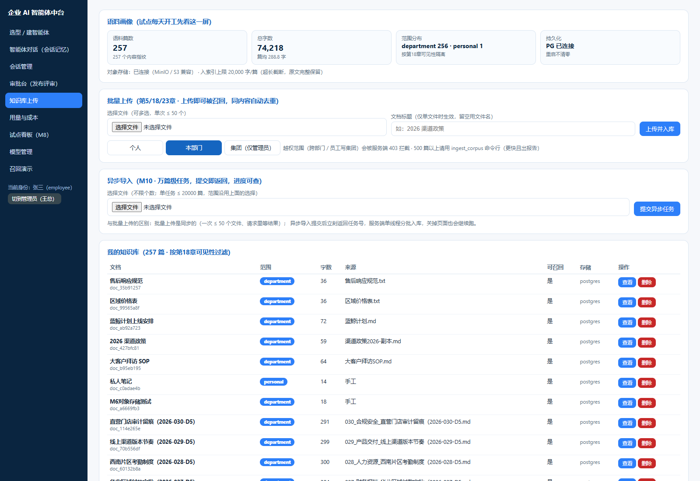

# M10 多租户规模化报告（三个部门 · 2400 篇 · 一万篇边界）

> **一句话结论**：M10 把「一个部门能跑」推到「三个部门共用一套索引、互不串味」。压测暴露了一个 M9 没机会暴露的真缺陷——**过滤点在聚合之后，规模化后会把候选窗口吃光，用户看到「知识库没有这条制度」，而文档就在库里**（2400 篇 / 3 部门实测出现 5 条空结果）。把同一份判权函数前移到候选阶段后：空结果 5 → **0**、检索 p50 46ms → **19ms**、泄露始终 **0 条**、部门内 Recall@10 **1.0**。另把万篇导入做成异步任务（提交即返回 + 进度可查），不再让一个请求干等几十秒。

## 0. 这次到底补了什么

| 能力 | M9 | M10 |
| --- | --- | --- |
| 过滤时机 | 聚合后过滤（候选窗口先被别的部门占满） | **候选阶段按身份预筛** + 聚合后兜底（同一份判权函数，两个调用时机） |
| BM25 成本 | 全候选逐条打分，1.6 万次/查询 | 先按 idf 加权命中数粗排，**截断到 3000 再精算** |
| 导入方式 | 同步 bulk（≤50 文件/次）、CLI | **异步任务** `/kb/ingest`（≤20000 篇/任务，进度可查、可取消） |
| 原文写入 | 逐篇串行 PUT 对象存储（19ms/篇） | **8 路并发写**（4.5ms/篇），吞吐 ×4 |
| 并发写 | 无锁（导入与上传同时打会坏索引） | 索引读写串行化（可重入锁） |
| 多租户验证 | 单部门语料 | **3 部门 2485 篇 + 其他租户 80 篇 + 他人私有 5 篇，6 个身份各 24 条 query 零泄露** |
| 规模边界 | 2700 篇实测 | **10 000 篇 / 122 084 子块 / 500MB 实测** |

## 1. 多租户压测（2485 篇 / 3 部门 / 6 个身份）

语料构成：`d_sales` 885 篇（含 80 篇其他租户同名文档）、`d_after` 800 篇、`d_fin` 800 篇，另有 5 篇「别人私有的」personal 文档。三个部门的文档**同题不同版本**（同一份制度各自的数字），这是最坏情况——谁检索都有三个近似答案。

| 身份 | 命中 | 空结果 | 泄露 | Recall@10 | MRR@10 | p50 | p95 |
| --- | --- | --- | --- | --- | --- | --- | --- |
| 销售部管理员 | 24/24 | 0 | **0** | 1.0 | 1.0 | 19.59 ms | 28.38 ms |
| 售后部管理员 | 24/24 | 0 | **0** | 1.0 | 1.0 | 19.12 ms | 22.42 ms |
| 财务部管理员 | 24/24 | 0 | **0** | 1.0 | 1.0 | 19.82 ms | 24.22 ms |
| 销售部员工 | 24/24 | 0 | **0** | 1.0 | 1.0 | 19.78 ms | 24.46 ms |
| 平台管理员（看全量） | 24/24 | 0 | 0 | —（跨部门，不评估） | — | 21.19 ms | 25.74 ms |
| 其他租户管理员 | 24/24 | 0 | **0** | —（无本租户文档） | — | **8.33 ms** | 12.32 ms |

两个细节值得看：

- **其他租户的 p50 只有 8.33ms**（别人 19–21ms）。因为预筛把他的可见集合砍到 80 篇，向量点积与 BM25 都只算这 80 篇。这反向证明预筛是真的在裁候选，不是「先全算再过滤」。
- **平台管理员 p50 最高（21.19ms）**：他看全量，没有一行的被裁掉，是一次真正的全语料检索。这也说明 19ms 里没有水分。

导入侧：800 篇/部门，分别 7.0s / 5.2s / 5.3s（**137 篇/秒**，含真实 MinIO 写入），三个部门合计 17.5s。

## 2. 压测暴露的真缺陷：过滤在聚合之后

第一版压测结果（修复前）：

| 身份 | 空结果 | p50 |
| --- | --- | --- |
| 售后部管理员 | **3** | 46.34 ms |
| 财务部管理员 | **2** | 54.94 ms |
| 销售部管理员 | 0 | 46.18 ms |
| 其他租户 | 19 | 53.99 ms |

售后部管理员搜「华东大区渠道政策怎么规定」返回空——**而售后部自己有 800 篇文档，其中就有这份制度**。

根因在检索链路的结构上：

```python
top_idx   = ordered[:max(200, top_k)]      # 只取 200 个子块当候选
reranked  = rerank(query, candidates)      # 对 200 个候选精排
agg       = sorted(parent_best...)         # 聚合回父文档
visible_items, _ = single_filter(agg, caller)   # ← 到这里才过滤
```

三个部门都有同题文档时，这 200 个候选里可能 190 个属于别的部门（它们的文本几乎一样，打分自然接近）。过滤完只剩 10 个甚至 0 个。**过滤没做错，位置错了**：它在候选窗口之后，而窗口是共享的。

同时还有一个隐性浪费：那 190 个「反正要扔掉」的候选，每个都跑了 BM25 打分（1.6 万次/查询），占了 46ms 里的 34ms。

### 修法：候选阶段预筛（判权函数不变）

`filter.py` 把判定内核抽成 `visible_fields(scope, owner, dept, tenant, caller)`，`visible(meta, caller)` 变成它的薄包装——**第18章的判权逻辑仍然只有一份**。然后 `knowledge.retrieve` 在候选阶段调用同一个函数：

```python
mask = _vis_mask(caller)                       # 按身份算一次可见行掩码，按身份缓存
vec_order, score_map = _vector_rank(qvec, head, mask=mask)   # 向量路只在可见行里排
cand = _bm25_candidates(qtoks, n, mask)                     # BM25 只给可见行打分
```

- 掩码按 `(tenant, dept, user, role)` 缓存，**任何写入/删除都清空**（新文档可能改变可见集合）。
- 掩码全 True（单部门语料）时直接返回 `None`，走原来的路径、不多付一分钱——M9 的性能数据不受影响。
- 聚合后的 `single_filter` **保留不动**，作为兜底。`filtered_out` 因此通常变成 0：不是过滤失效了，是根本轮不到它出手。

修复后：空结果 5 → **0**，p50 46ms → **19ms**（省掉的正是那 1.6 万次无用 BM25）。`filtered_out` 语义变化也让 3 条老断言失效，改成直接断言「不可见文档不出现」——比断言兜底计数更贴近红线。

## 3. BM25 也要有成本上限

`_bm25_candidates` 原来「候选 > 全量 60% 就退回全扫」，等于没有上限。query 里只要有几个高频词（"怎么""规定""的"），候选就能涨到 1.6 万行。

改成按 **idf 加权命中数**粗排后截断：

```python
for t in qtoks:
    w = _IDF.get(t, 0.5)
    for r in _INV[t]:
        cand[r] = cand.get(r, 0.0) + w      # 命中词 idf 之和 = BM25 分子
...
if len(cand) > 3000:
    return [i for i, _ in sorted(cand.items(), key=lambda kv: -kv[1])[:3000]]
```

截断是**安全的**：BM25 的分母只跟文档长度有关，分子就是「命中词 idf 之和」。按分子取前 3000 名再精算，漏掉的只能是「只命中高频词」的行——它们本来也排不进 top-100。

效果：2400 篇下 BM25 打分次数从 16 401 降到 ≤3000，检索 p50 46ms → 19ms。**并且成本从此与语料规模无关**——一万篇也是 ≤3000 次。

## 4. 异步导入：万篇不再占着一个请求

同步 `/kb/documents/bulk` 一次最多 50 个文件，1 万篇要分 200 次请求；CLI 能导入但不在服务里。真实客户把 1 万篇丢进来时，同步接口会占住一个 worker 几十秒（接真 embedding 后是分钟级）。

`POST /kb/ingest` 的设计取舍：

| 决策 | 取值 | 理由 |
| --- | --- | --- |
| 并发度 | **单 worker 串行** | 索引不是并发安全的容器，多任务并行只会互相破坏；串行还保证「先提交先完成」，进度条不跳 |
| 分批 | 200 篇/批 | 进度可见粒度 + 单批失败不影响已入库的 |
| 上限 | 20000 篇/任务 | 防一次请求打爆内存；更大规模拆任务 |
| 任务单 | 只存内存 | 重启丢任务单不丢数据（文档在 PG）；为任务单建表不值 |
| 取消 | 尽力而为 | 当前批跑完就停，已入库的不回滚 |

配套：`GET /kb/ingest/{job_id}` 查进度、`GET /kb/ingest` 最近任务（本人，平台管理员看全租户）、`POST /kb/ingest/{job_id}/cancel`。前端知识库页新增「异步导入」卡片：选文件 → 提交 → 进度条轮询（可离开页面）。

实测：契约脚本提交 12 篇 → `done`，耗时 0.085s；测试里 300 篇 / 500 篇两个任务进度单调递增、终态可查、跨用户不可见。



## 5. 导入吞吐的真瓶颈是对象存储，不是索引

跑到 2400 篇才发现：`register_many` 100 篇要 1.79s，而其中索引只占 **0.023s**。剩下的全是每篇一次 `put_text`（MinIO PUT，实测 **19ms/篇**）。

并发度实测（200 次 PUT，同一份客户端）：

| 并发 | 单篇耗时 | 相对串行 |
| --- | --- | --- |
| 1 | 19.03 ms | 1.0× |
| 4 | 6.26 ms | 3.0× |
| **8** | **4.55 ms** | **4.2×** |
| 16 | 5.57 ms | 3.4×（过度并发反而慢） |

所以取 8 路线程池写原文，返回顺序仍按原批次。**结论：索引早就不是瓶颈了，IO 才是。**（16 路变慢是因为超过了 MinIO/localserver 的舒适并发度。）

PG 在位时另测：100 篇 0.807s（8.07ms/篇，含 PG upsert + 对象存储），即 **124 篇/秒**；离线（PG 不可达）时 137 篇/秒。

## 6. 一万篇实测

| 规模 | 子块 | 导入耗时 | 检索 p50 | p95 | vec 内存 | 空结果 |
| --- | --- | --- | --- | --- | --- | --- |
| 2 485 篇 / 3 部门 | 30 358 | 17.5 s（含 MinIO） | 19.1–21.2 ms | 22–28 ms | 124 MB | 0 |
| **10 000 篇 / 4 部门** | **122 084** | **23.8 s**（纯索引路径） | **31.9 ms** | 63.9–71.4 ms | **500 MB** | **0 / 12** |

一万篇的 p50 31.9ms、p95 71ms，**没有出现空结果**——预筛 + 候选截断在 4 个部门、12 万子块下依然成立。

### 容量边界（更新 M9 的表）

| 规模 | 子块 | 检索 p50 | vec 内存 | 建议 |
| --- | --- | --- | --- | --- |
| 2 500 篇 / 3 部门 | 30k | 19 ms | 124 MB | memory 后端，默认配置即可 |
| 10 000 篇 / 4 部门 | 122k | 32 ms | 500 MB | memory 仍可用，但要盯 `capacity_used_pct` |
| 20 000 篇 | ~245k | 估 60–80 ms | ~1 GB | 切 `VECTOR_BACKEND=qdrant`（远程 http） |
| 50 000 篇+ | ~610k | — | ~2.5 GB | 必须上 qdrant + 分片，考虑把原文从 MinIO 改为按需读 |

判断依据仍是 `/kb/index` 三个数：`capacity_used_pct` >0.6 规划迁移、`last_query_ms` >100ms 换后端、`embed_cache.hit_rate` 长期 0 说明缓存没生效。

## 7. 并发写安全

后台任务 + 同步上传会同时打进来，而索引是「预分配矩阵 + 倒排表 + tombstone 位图」的组合结构，写一半被读到会看到半截状态（行数对不上、倒排指向未写入的行）。

`knowledge.py` 加一把**可重入锁**，把 `retrieve` / `add_document` / `add_documents_bulk` / `remove_documents` 串起来：

```python
def _locked(fn):
    @functools.wraps(fn)
    def wrapper(*args, **kwargs):
        with _WRITE_LOCK:
            return fn(*args, **kwargs)
    return wrapper
```

进程内单写者、读也不并发。3ms 的锁持有期换来「不会再出现幽灵召回」，值得。

## 8. 回归状态

| 项 | 结果 |
| --- | --- |
| `pytest` | **79 passed**（M9 72 → M10 新增 7 项，`tests/test_m10_multitenant.py`） |
| Recall@100 门禁 | 1.0 通过（275 篇 / 3066 子块，MRR 0.9659 / NDCG 0.9748，与 M9 逐位一致） |
| 多租户泄露 | **0 条**（6 身份 × 24 query × 2 轮） |
| 前端契约 | 全通过（新增 `/kb/ingest` 三项断言：受理 / 跑完 / 列表） |
| 前端构建 | `npm run build` 通过（190.79 kB / gzip 62.75 kB） |
| openapi | **27 paths / 24 schemas**（新增 `/kb/ingest`、`/kb/ingest/{job_id}`、`/kb/ingest/{job_id}/cancel`，两份同步） |

M10 新增的 7 项测试：任务生命周期、进度单调、上限拒绝（413）、跨用户不可见（含跨租户管理员）、跨部门零泄露且不返回空结果、掩码复用与写入失效、异步导入后删除不再召回。

> 一个测试坑：M10 测试会往语料里灌近千篇文档，如果不清场，后面跑的 M4 召回类断言会因为语料被稀释而**假性失败**（第一版就是这么挂的）。现在模块级 fixture 跑完即清。

## 9. 没做/未验证的（明说，不编数据）

1. **qdrant 远程（http）模式仍未验证**：本机 Docker daemon 没起（`npipe` 连不上），本轮只跑通 `QDRANT_MODE=local` 文件模式。命令已备：`docker compose up -d qdrant` 后 `VECTOR_BACKEND=qdrant QDRANT_MODE=http`。
2. **真实 bge-m3 向量化没跑**：本地无模型缓存，下载无保证，压测仍用确定性伪向量（可复现、不依赖网络）。接真模型后 embed 会主导导入耗时，`EMBED_CACHE` 的收益会更大——需要单独一轮带模型压测。
3. **一万篇是「纯索引路径」实测**（`add_documents_bulk`），没有走 1 万个 MinIO PUT。按 4.55ms/篇估算，全链路约 +45s，异步任务正是为此设计。
4. **任务单不持久化**：重启后 `/kb/ingest` 列表清空（文档不丢）。若需要审计，下一轮再落 PG。
5. **PG upsert 仍是逐条**：PG 在位时 8.07ms/篇里有相当一部分在这里，可改批量 `executemany`，本轮没做。

## 10. 怎么复现

```bash
cd D:/enterprise-ai-platform/backend

# 多租户压测（3 部门 × 800 篇 + 其他租户噪声 + 6 个身份探针）
./.venv/Scripts/python.exe scripts/bench_multitenant.py --per-dept 800
# 连真 PG（会写库，默认不连）
./.venv/Scripts/python.exe scripts/bench_multitenant.py --per-dept 100 --with-pg

# 异步导入冒烟（进程内）
./.venv/Scripts/python.exe -c "
from fastapi.testclient import TestClient; from app.main import app
c=TestClient(app); tk=c.post('/api/v1/auth/sso/callback',json={'provider':'wecom','code':'dev','device_id':'dev','state':'x'}).json()['data']['token']
r=c.post('/api/v1/kb/ingest',json={'documents':[{'title':f'x{i}','content':f'第 {i} 篇'} for i in range(500)],'scope':'department'},headers={'Authorization':tk})
print(r.json()['data']['job_id'])"

# 全量回归（79 项）
./.venv/Scripts/python.exe -m pytest -q
```
